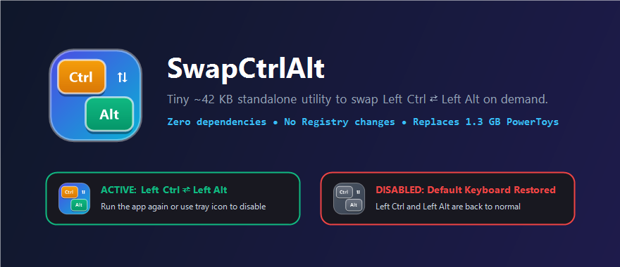

# SwapCtrlAlt

<p align="center">
  
</p>

**SwapCtrlAlt** is an ultra-lightweight (~42 KB), zero-dependency Windows desktop utility that swaps **`Left Ctrl` ⇄ `Left Alt`** on demand.

### Why SwapCtrlAlt?
If you use a programmable mechanical keyboard at home (where modifiers are already mapped in QMK/VIA), you don't want background services running 24/7 or modifying your Windows Registry. However, when taking your laptop out to a café, you may want to quickly swap `Left Ctrl` and `Left Alt` and turn it right back off when you get home.

Keeping **Microsoft PowerToys (~1.3 GB)** installed just for its Keyboard Manager is overkill. **SwapCtrlAlt** solves this in a single **42 KB** portable executable:

- **Zero Installation / Zero Dependencies:** Compiles with the built-in Windows `.NET Framework` compiler (`csc.exe`) that ships with every Windows 10/11 PC.
- **No Registry Modifications & No Reboot:** Uses a clean low-level keyboard hook (`WH_KEYBOARD_LL`) in user-space.
- **Instant Double-Click Toggle:**
  - **1st Double-Click:** Activates `Left Ctrl ⇄ Left Alt` and displays a sleek floating HUD toast at the top of your screen.
  - **2nd Double-Click:** Immediately unhooks, releases any held modifiers, restores default keyboard behavior, and exits cleanly.
- **System Tray Control:** Also sits quietly in the System Tray where you can double-click to temporarily pause/resume or right-click to exit.
- **AltGr Safe:** Ignores synthetic `Left Ctrl` events generated by international `Right Alt` (`AltGr`) layouts.

---

## Quick Start

### Option 1: Download Pre-built Binary
Download **`SwapCtrlAlt.exe`** (~42 KB) from the [**Releases**](../../releases) page and place it on your Desktop.

### Option 2: Build from Source (No SDK / Visual Studio Required)
Every Windows 10/11 installation already includes `csc.exe`. Clone this repository and run `build.bat`:

```bat
git clone https://github.com/JohnnyTradingDev/SwapCtrlAlt.git
cd SwapCtrlAlt
build.bat
```

This generates:
- `assets\SwapCtrlAlt.ico` — Multi-resolution (256px–16px) high-DPI icon
- `dist\SwapCtrlAlt.exe` — Standalone 42 KB executable

---

## Usage

| Action | Result |
| :--- | :--- |
| **Double-click `SwapCtrlAlt.exe` (1st time)** | **Enables** `Left Ctrl ⇄ Left Alt` + shows green `ACTIVE` floating HUD |
| **Double-click `SwapCtrlAlt.exe` (2nd time)** | **Exits** and restores default keys + shows red `DISABLED` floating HUD |
| **Double-click System Tray Icon** | Temporarily **Pauses / Resumes** key swapping |
| **Right-click System Tray Icon** | Context menu to **Pause/Resume** or **Exit** |

---

## License
Released under the [MIT License](LICENSE).
